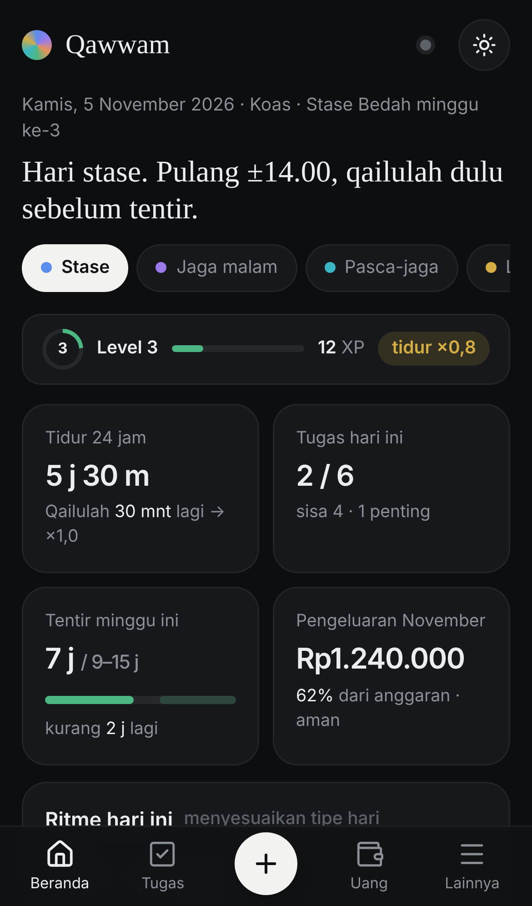
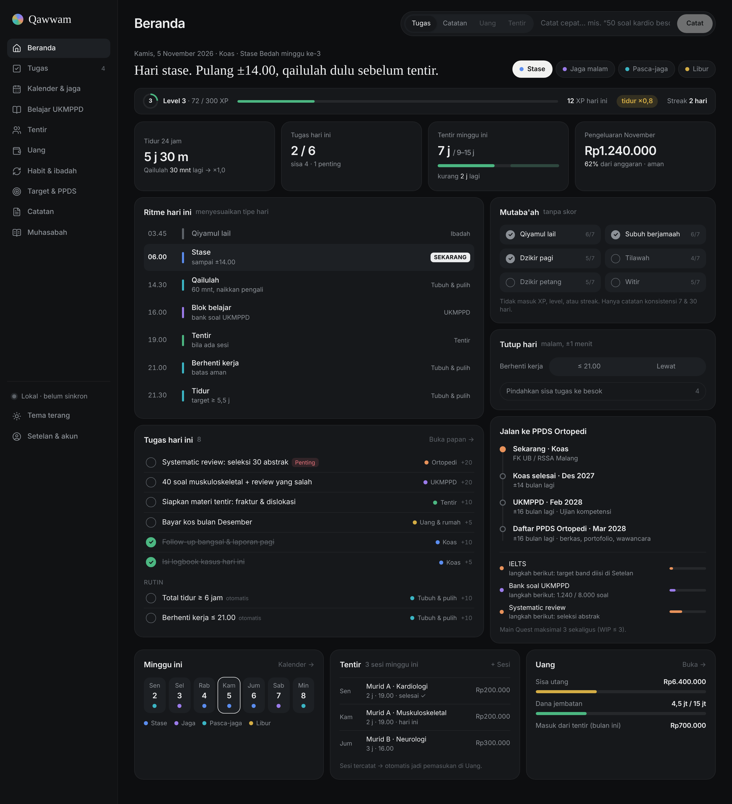

# Qawwam

**Qawwam** (قَوَّام): yang terus-menerus tegak menjalankan sesuatu. Satu app untuk mengatur hidup selama **koas → UKMPPD → PPDS Ortopedi**: tipe hari, tugas per peran, tidur, mutaba'ah, tentir, dan uang. Menggabungkan [MBAPPE OS](https://github.com/rifqihh1689-hash/levelup) dan [Dompetku](https://github.com/rifqihh1689-hash/dompetku).

PWA offline-first: bisa dipasang di layar utama HP, iPad, dan laptop, jalan tanpa internet, dan tersinkron lewat Dexie Cloud. Keputusan desain lengkap ada di [DESIGN.md](DESIGN.md).

<table>
  <tr>
    <td align="center" valign="top"><br /><sub>HP</sub></td>
    <td align="center" valign="top"><br /><sub>Laptop</sub></td>
  </tr>
</table>

<sub>Screenshot memakai data contoh.</sub>

## Yang sudah ada (Fase 1)

- **Beranda**: kalimat pembuka per tipe hari, strip level/XP/pengali tidur/streak, tidur 24 jam, tugas, tentir, pengeluaran, ritme hari ini, tugas + rutin, prioritas minggu ini, mutaba'ah tanpa skor, tutup hari, jalan ke PPDS, minggu ini.
- **Tipe hari**: Stase / Jaga malam / Pasca-jaga / Libur, dengan saran otomatis. Pasca-jaga memindah tugas non-pemulihan ke besok. Jaga dan pasca-jaga tidak memutus streak.
- **Catat cepat**: `50 soal kardio besok` → tugas UKMPPD untuk besok. Kenal `besok`, `lusa`, nama hari, tagar peran (`#orto`), dan `!` untuk penting.
- **Tugas**: tampilan Hari atau papan Minggu (satu kartu per hari, tambah langsung di harinya), label peran, subtugas, pindah ke besok, urungkan.
- **Habit & mutaba'ah**: kotak 7 hari, habit per tipe hari & hari dalam minggu, target menit, tambah cepat dari habit MBAPPE OS; mutaba'ah netral dengan konsistensi 7 & 30 hari.
- **Muhasabah mingguan**: 8 angka minggu itu, selesai vs belum, refleksi dan 3 prioritas minggu depan (tampil di Beranda), +50 XP sekali seminggu (Sabtu–Selasa).
- **XP dari MBAPPE OS**: `round(min(Σ, 100) × pengali tidur) − 15·[lewat 21.00]`, pengali dari tidur malam + qailulah. Hari lama dibekukan.
- **Tanpa identitas pasien**: No. RM, angka ≥ 6 digit, Tn./Ny./An. + nama mengunci tombol simpan di semua kolom teks.
- **Menu & makan**: target protein dari berat badan × 1,6 g/kg, 3–5× makan sesuai fase bulk/maintain/cut, menu bawaan ayam & telur (beli/masak), isi otomatis seminggu mengikuti tipe hari dan anggaran, daftar belanja jadi tugas, kartu "Makan hari ini".
- **Jadwal fleksibel**: jam masuk/pulang per stase, ritme harian per tipe hari (Setelan), kalimat pembuka ikut jam pulang.
- **Impor MBAPPE OS**: pilih file export (atau tempel JSON) di halaman Impor; hari & XP beku, quest → habit, mutaba'ah, stase, Main Quest, Raid → Muhasabah, utang & dana jembatan ikut. Data Qawwam tidak ditimpa, aman diulang.
- **Impor jadwal**: tempel sel Google Sheets/CSV atau balasan Claude (untuk screenshot, PDF, catatan program latihan) → pratinjau → impor. Jenis: ritme, habit/latihan, tugas, jaga, stase. Aman diulang.
- **Sinkron**: Dexie Cloud dengan layar masuk berbahasa Indonesia (email + kode). **Setelan**: tema, stase, ritme, fase hidup & peran, export JSON.

## Menjalankan di komputer

Prasyarat: Node.js 22.22+ (atau 24.15+).

```bash
npm install
npm run dev        # http://localhost:5173
npm test           # Vitest
npm run lint       # oxlint
npm run build      # hasil di dist/
```

Di mode dev, buka konsol browser lalu jalankan `__qawwamSample()` untuk mengisi data contoh.

## Sinkron (Dexie Cloud)

Tanpa langkah ini app tetap jalan, tapi data hanya di perangkat itu. Langkah ini butuh email kamu, jadi dijalankan sendiri di terminal (sekali saja):

1. Buat database. Perintah ini meminta email lalu kode OTP yang dikirim ke email itu:

   ```bash
   npx dexie-cloud create
   ```

   Hasilnya dua file: `dexie-cloud.json` (berisi URL database) dan `dexie-cloud.key` (kunci rahasia). Keduanya sudah di `.gitignore`. **Jangan pernah di-commit atau ditempel ke chat.**

2. Izinkan alamat app memakai database:

   ```bash
   npx dexie-cloud whitelist https://rifqihh1689-hash.github.io
   npx dexie-cloud whitelist http://localhost:5173
   ```

3. Untuk dev lokal, salin `.env.example` ke `.env.local` dan isi `VITE_DEXIE_CLOUD_URL` dengan URL dari `dexie-cloud.json`.

4. Untuk versi online, di GitHub: **Settings → Secrets and variables → Actions → Variables → New repository variable**, nama `DEXIE_CLOUD_URL`, isi URL yang sama. URL ini bukan rahasia.

Setelah itu, setiap perangkat masuk sekali dengan email + kode, lalu tetap bisa dipakai offline. Paket gratis Dexie Cloud: 3 pengguna produksi, 100 MB.

## Deploy ke GitHub Pages

Workflow [`.github/workflows/deploy.yml`](.github/workflows/deploy.yml) menjalankan cek format, lint, tes, dan build di setiap pull request, lalu deploy otomatis setiap push ke `main`.

Sekali saja: **Settings → Pages → Build and deployment → Source: GitHub Actions**. Alamatnya `https://rifqihh1689-hash.github.io/<nama-repo>/` (path mengikuti nama repo, jadi aman kalau repo diganti nama, mis. menjadi `qawwam`).

## Saat fase hidup berganti

Tidak ada yang direset. Di **Setelan**: isi tanggal selesai fase lama, tambah fase baru, ganti label tipe hari per fase (mis. "Stase" → "Dinas"), arsipkan peran lama dan tambah yang baru. Tugas, XP, level, dan streak berlanjut; hari yang sudah lewat dibekukan. Detail di DESIGN.md › Saat fase hidup berganti.

## Teknologi

React + TypeScript + Vite, Tailwind CSS, ikon Lucide, IndexedDB lewat Dexie + Dexie Cloud, vite-plugin-pwa, Vitest + Testing Library + fake-indexeddb, oxlint, Prettier. Router berbasis hash agar aman di GitHub Pages.
